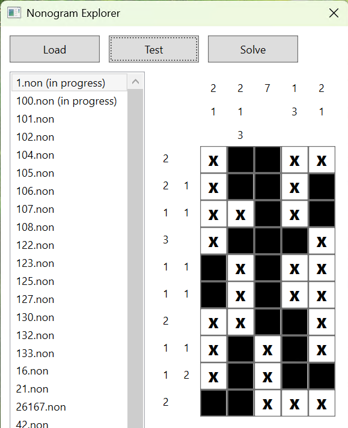
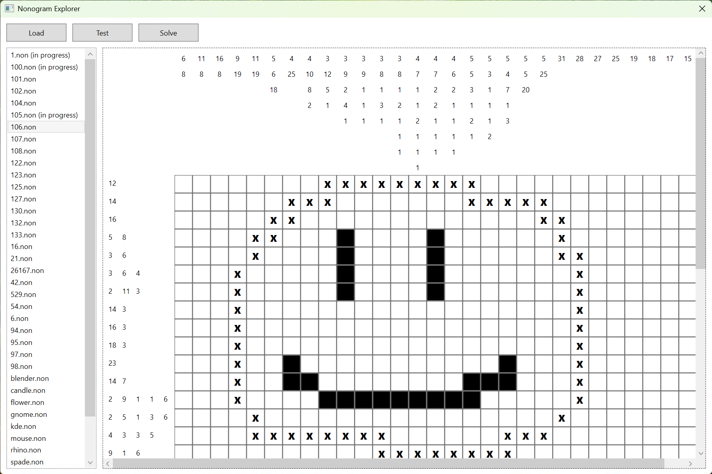
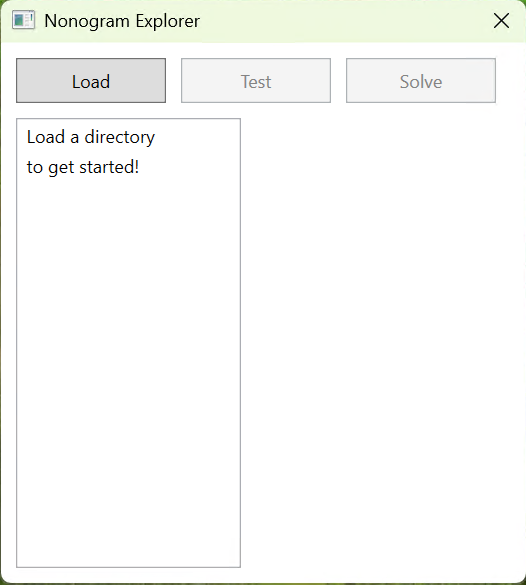

# Nonogram Explorer

A .NET WPF application to play nonograms.
Includes the ability to switch between puzzles and save your progress.

## Installation

Download the latest release, extract, and run.
**Note:** You will need a version of .NET 8 or compatible installed. If none are present, you'll be prompted to download it upon execution.

## How to play

First, you need to load a directory with puzzles. There is one included in this repo, which can be downloaded separately on the release page (nonogram_directory.zip).

Then, pick a puzzle of your choice, and get started! Left click to mark squares, right click to add crosses. Holding and dragging is supported for both operations.

Once you think you're done, press the 'Test' button to check your solution.

Your progress is saved automatically upon switching levels or closing the app. It is reloaded automatically when loading the level.
There is no way to reset level progress within the app, you will need to delete the [puzzle name].non.progress file in your puzzle directory.

The 'Solve' button is not functional.

## Creating puzzles

There is no level creation interface, feel free to create your own, edit a text file directly, or download levels online.
The .non format used by this program is based on [mikik's](https://codefloe.com/mikix/nonogram-db/src/branch/master/FORMAT.md) specification, itself taken from Steve Simpson's. The level library in this repo is taken from mikix's [nonogram-db](https://codefloe.com/mikix/nonogram-db/).

## Screenshots

